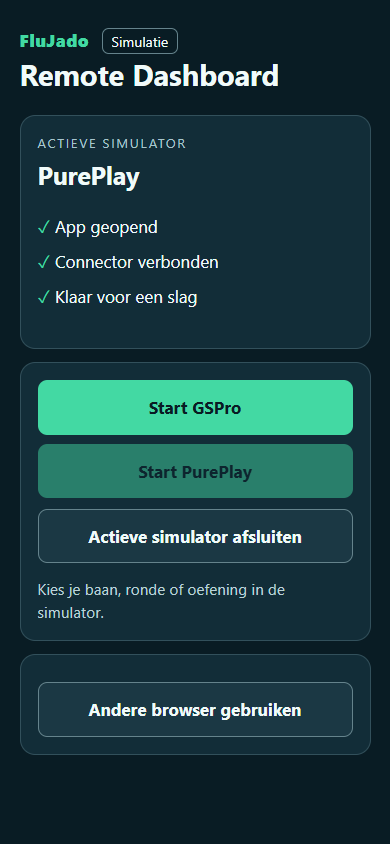

# FluJado beta.18.21

[Download MSI](../../downloads/FluJado-Golf-Sim-Hub-0.9.0-beta.18.21.msi) · [Release notes](RELEASE-NOTES.txt) · [Checksums](SHA256SUMS.txt) · [Compatibility](../../COMPATIBILITY.md)

[English and Dutch manuals, screenshots and connector guide](../beta.18.17/README.md)

## English

Use **Install update** in the Hub if you already use MSI. The Hub offers a transition installer to older EXE installations. On a new PC, install and test the simulator and connector first.

- **GSPro + ProTee VX:** Start from the tile with Labs closed. Check whether the Hub advances when Labs shows Ready and whether GSPro opens.
- **GolfCore or PurePlay + ProTee VX:** Add the assisted ProTee Labs tile in Guided Setup. Check the game executable. Select the game in Labs under Game Options, enable Auto-Connect, leave Launch Game When Labs Starts off and click Connect. In PurePlay choose ProTee as the launch monitor. If the link drops, try Connect after the game has opened. Record a real shot, close via the Hub and report any apps left open.
- **ShotForge + Eye Mini Lite via rēlā:** Check whether a real shot arrives when both sides show connected. Note the plugin and connector versions.
- **Muni + VTrack:** Play several holes and note whether Ready remains visible when shots stop registering.
- **Drills Web + VTrack:** Identify the actual receiver and its listening port before testing the standalone connector. Report real shot delivery separately from a connected indication.
- **PurePlay + Foresight via rēlā:** Compare ball flight delay and club data with Split Packets off and on. For Square, report reconnects and whether the next ball is detected.

## Nederlands

Gebruik **Install update** in de Hub als je al MSI gebruikt. De Hub biedt oudere EXE-installaties een overgangspakket aan. Installeer en test op een nieuwe pc eerst de simulator en connector.

- **GSPro + ProTee VX:** Start met Labs gesloten via de tegel. Controleer of de Hub doorgaat bij Ready en GSPro opent.
- **GolfCore of PurePlay + ProTee VX:** Voeg in Guided Setup de begeleide Labs-tegel toe. Controleer het gamepad, selecteer het spel in Labs onder Game Options, zet Auto-Connect aan en laat Launch Game When Labs Starts uit. Klik Connect. Kies in PurePlay eenmalig ProTee. Klik opnieuw op Connect als de koppeling wegvalt nadat het spel is geopend. Test een echte slag en afsluiten via de tegel.
- **ShotForge + Eye Mini Lite via rēlā:** Controleer of een echte slag doorkomt als beide kanten verbonden melden. Noteer de plug-in- en connectorversie.
- **Muni + VTrack:** Speel meerdere holes en kijk of Ready blijft staan wanneer slagen uitvallen.
- **Drills Web + VTrack:** Stel eerst vast welke ontvanger en poort bij de losse connector horen. Meld een echte ontvangen slag afzonderlijk.
- **PurePlay + Foresight via rēlā:** Vergelijk de vertraging en clubdata met Split Packets uit en aan. Meld bij Square wat er gebeurt bij opnieuw verbinden en de volgende bal.

## In development / In ontwikkeling

The Control Dashboard is shown with simulated data and is separate from beta.18.21. Het dashboard toont gesimuleerde data en volgt apart.

