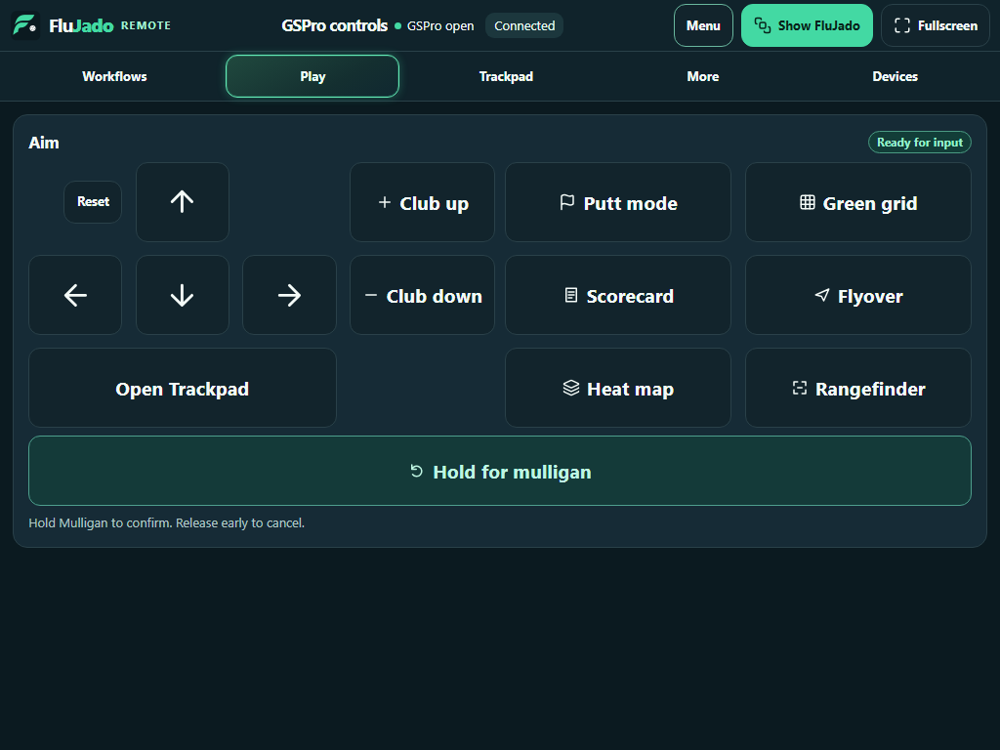
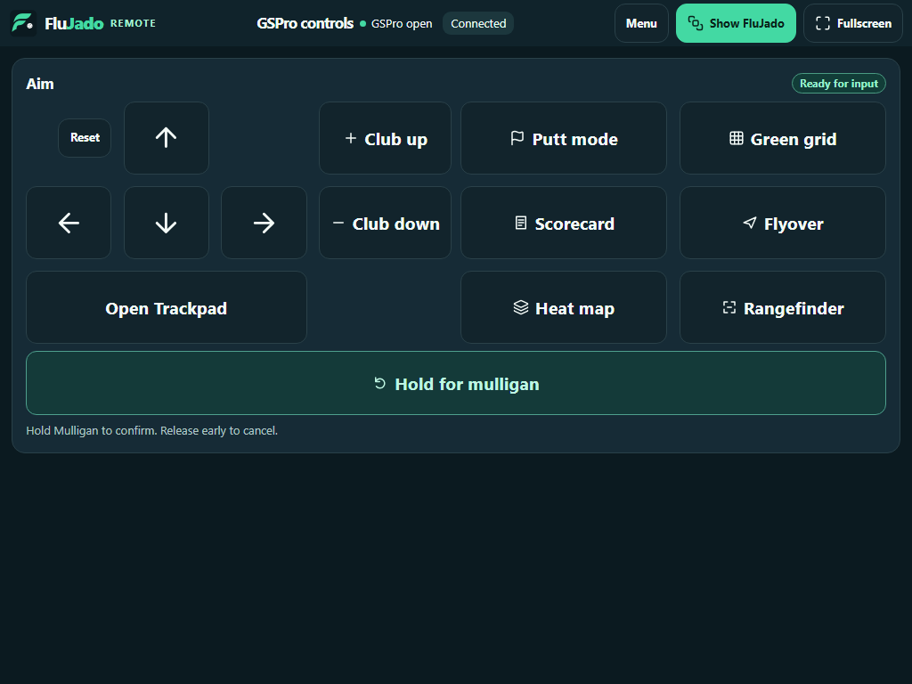

# FluJado beta.18.25

> **Superseded by beta.18.26.** The beta.18.25 installer is withdrawn because it used a test licence path. [Get beta.18.26](../beta.18.26/README.md).

[Compatibility](../../COMPATIBILITY.md)

- **Nederlands** · [Installatie en gebruik](FluJado-Beta-Handleiding-NL.txt) · [Remote Controls met screenshots](Remote-Controls-NL.md)
- **English** · [Installation and user guide](FluJado-Beta-User-Guide-EN.txt) · [Illustrated Remote Controls guide](Remote-Controls-EN.md)

## Remote Controls

Remote Control is off by default. When enabled, each tablet browser pairs by QR with approval on the simulator PC. The tablet dashboard shows workflow progress, switching confirmations, and simulator-specific controls.

## Installation and test coverage

From 18.24, use **Menu → Check for updates → Install update**. For a new installation, download the MSI. The clean installation and the upgrade from 18.24 passed, including automatic reopening and retention of tiles, settings and the test licence.

All nine ProTee VX tiles completed their live test without shots. ShotForge 2.x and Awesome Golf needed a repeat after reconnecting the VX. The tablet test covered workflow switching and delivery of safe controls in Chrome tablet emulation. See the [release notes](RELEASE-NOTES.txt) for scope and requested tester feedback.
