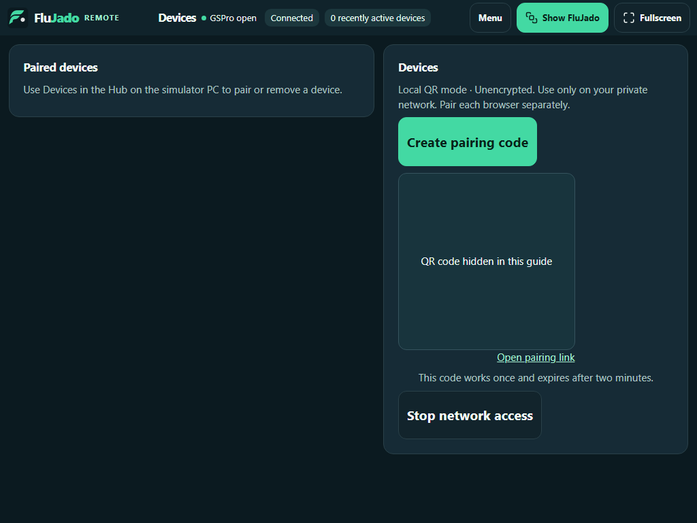
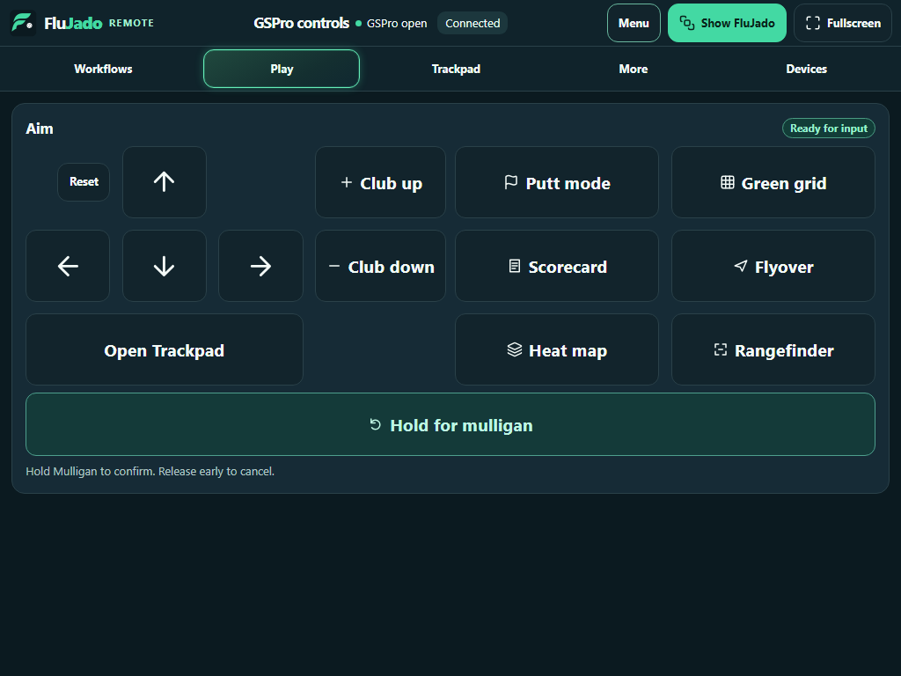
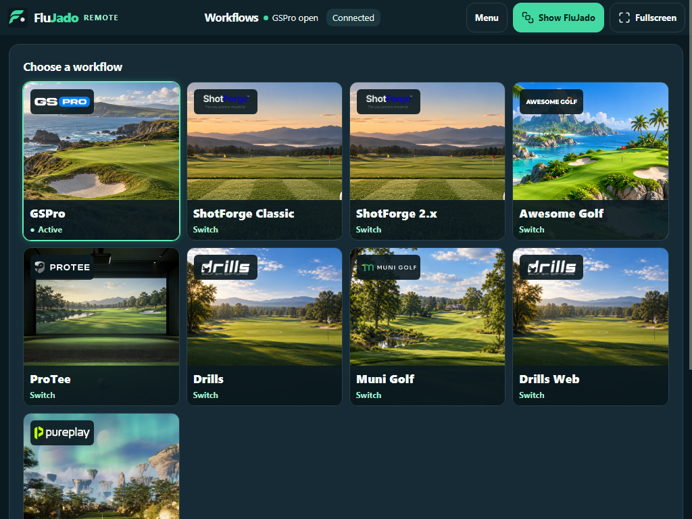
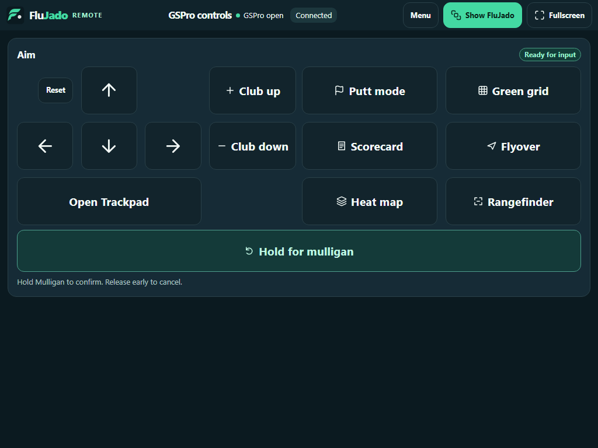

# FluJado Remote Controls · User guide

Use the tablet dashboard to start or switch simulators and use shortcuts in supported games. Choose a course or practice mode on the simulator PC when the game asks.

## 1. Pair your tablet with the simulator PC

1. Connect the tablet and simulator PC to the same trusted private network. Remote is off when FluJado starts.
2. Select **Remote Control** in the Hub and choose **Enable and open Devices**. If Remote is already on, select **Devices** in the Hub.
3. On the PC, select **Create pairing code**. Scan the QR code with your tablet camera and open the link in the browser you want to play with.
4. Give the tablet a name and tap **Pair this browser**. On the PC, select **Approve pairing** for the matching request. Create a new code if the current one expires.

## 2. Find your way around Menu

Tap **Menu** in the upper right. **Workflows** starts or switches games, **Play** shows the shortcuts for the active game, **Trackpad** controls the PC mouse, and **Devices** shows device options. On wider screens these tabs may be visible without opening Menu.

## 3. Start or switch from Workflows

Tap the tile you want. If asked to confirm a switch, save or finish your current round first. Follow progress and prompts on the dashboard. If Drills asks you to choose an exercise, select it in Drills on the PC. If PurePlay offers an optional update, choose **Nu updaten** (update now) or **Doorgaan zonder update** (continue without updating).

## 4. Control the simulator from Play

**Play** opens automatically after a supported simulator starts. Open a course or practice mode if the game still asks for one. Tap an arrow for a short aim adjustment or hold it for continued movement where supported. Release to stop. If you see **input paused**, tap **Back to [simulator]** to bring the game to the foreground. ShotForge Classic has no Play shortcuts in this beta.

To disconnect a tablet, open **Devices** on the simulator PC and remove the device there. Turn **Remote Control** off to stop tablet control.
