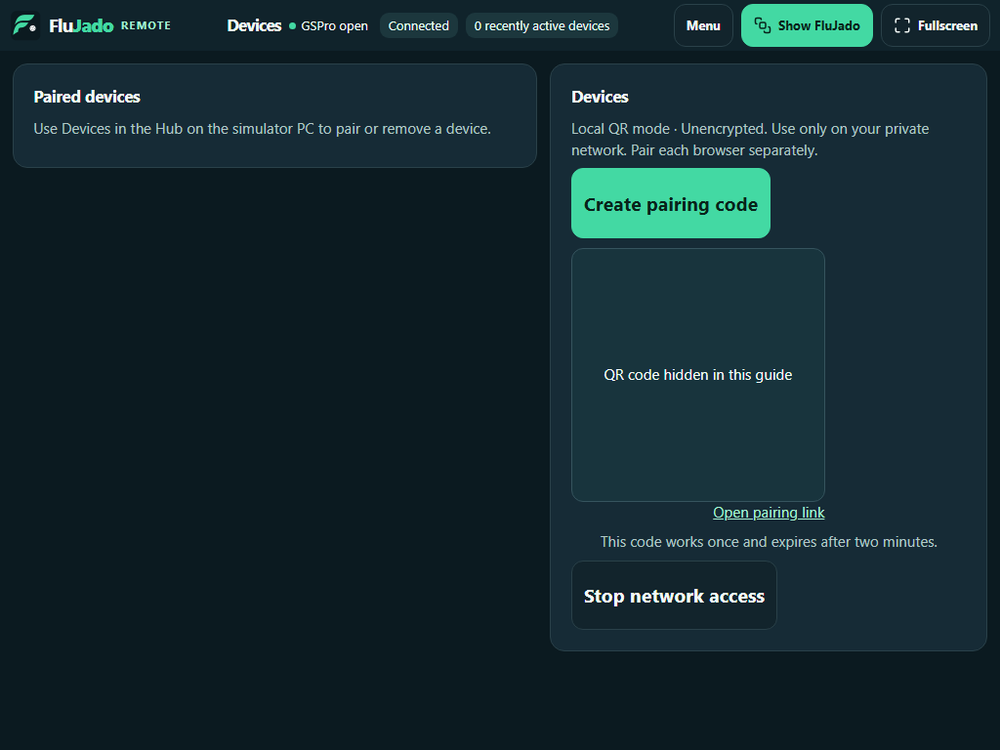
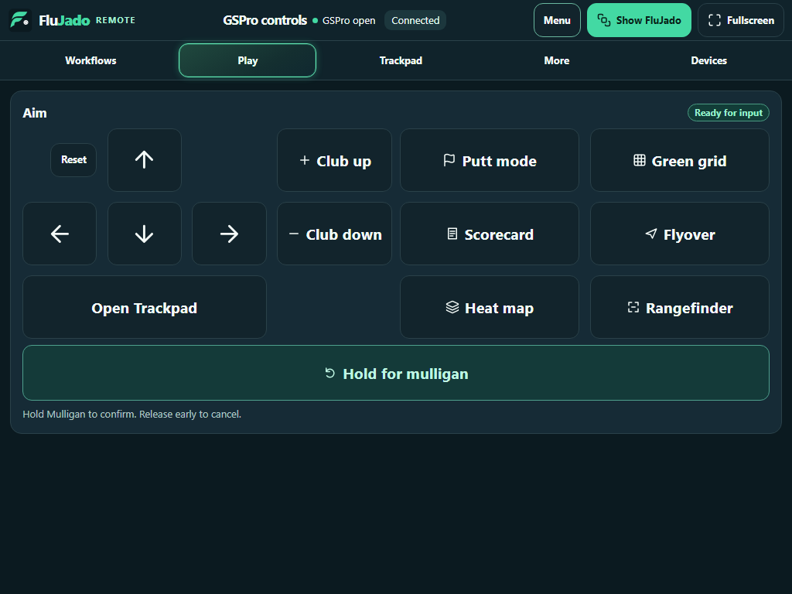
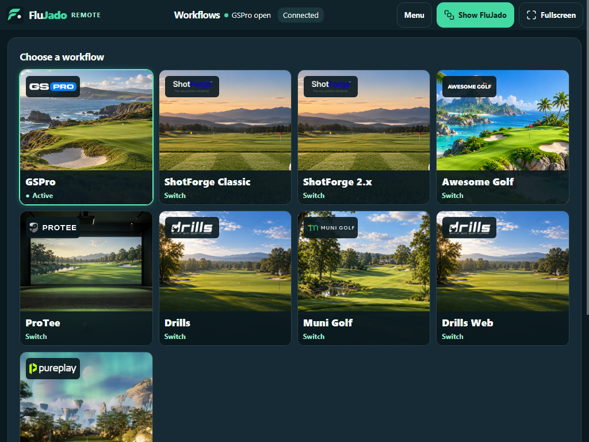
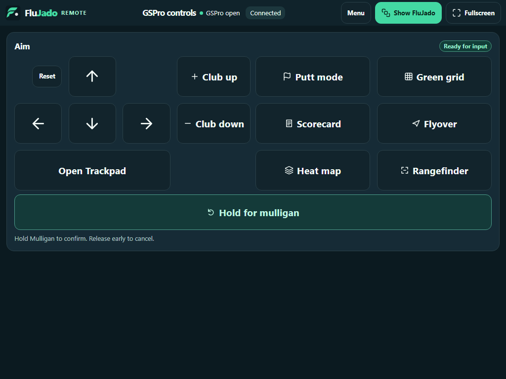

# FluJado Remote Controls · handleiding NL

Met het tablet-dashboard start en wissel je simulators en bedien je de sneltoetsen van een ondersteunde simulator. Kies een baan of oefenmodus waar nodig in het spel op de simulator-pc.

## 1. Koppel je tablet aan de simulator-pc

1. Verbind de tablet en de simulator-pc met hetzelfde vertrouwde privénetwerk. Remote staat bij de start van FluJado uit.
2. Klik bovenaan in de Hub op **Remote Control** en kies **Enable and open Devices**. Was Remote al aan, klik dan op **Devices** in de Hub.
3. Klik op de pc op **Create pairing code**. Scan de QR-code met de camera van je tablet en open de link in de browser waarmee je wilt spelen.
4. Geef je tablet een herkenbare naam en tik op **Pair this browser**. Klik op de pc op **Approve pairing** bij het bijbehorende verzoek. Maak een nieuwe code aan als die verlopen is.

## 2. Gebruik Menu op de tablet

Tik rechtsboven op **Menu**. Met **Workflows** start of wissel je een sim. **Play** bevat de knoppen voor de huidige sim. Met **Trackpad** bedien je de muis op de simulator-pc. **Devices** toont de apparaatopties. Bij een brede tabletweergave kunnen de tabbladen direct zichtbaar zijn.

## 3. Start of wissel via Workflows

Tik op de tegel die je wilt gebruiken. Bevestig een gevraagde wissel nadat je de huidige ronde hebt opgeslagen of afgerond. Volg de voortgang en eventuele instructies op het dashboard. Als Drills vraagt om een oefening, kies je die in Drills op de pc. Als de PurePlay-launcher een optionele update aanbiedt, kies je **Nu updaten** of **Doorgaan zonder update**.

## 4. Bedien je simulator via Play

Na een geslaagde start opent **Play** automatisch bij een ondersteunde sim. Open de gewenste baan of oefenmodus als het spel daar nog om vraagt. Tik eenmaal op een richtingspijl voor een korte beweging. Houd de pijl vast voor langer richten waar die bediening beschikbaar is. Laat los om te stoppen. Staat er **input paused**, tik dan op **Back to [simulator]** om het spel naar de voorgrond te halen. ShotForge Classic heeft in deze bèta geen Play-sneltoetsen.

Om een tablet te ontkoppelen, open je **Devices** op de simulator-pc en verwijder je het apparaat daar. Zet **Remote Control** uit wanneer je de tabletbediening wilt stoppen.
