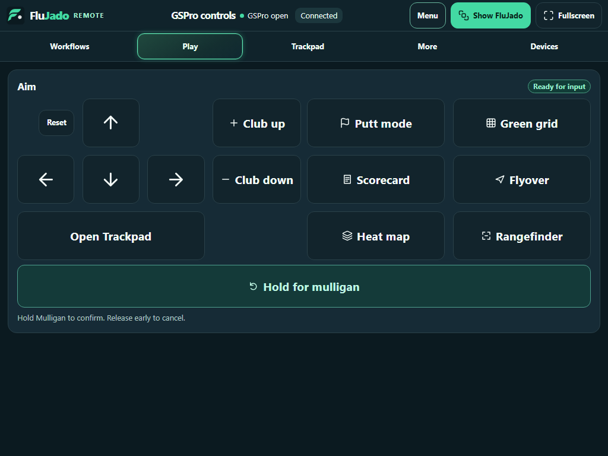

# FluJado beta.18.26

[Download MSI](../../downloads/FluJado-Golf-Sim-Hub-0.9.0-beta.18.26.msi) · [SHA-256](SHA256SUMS.txt) · [Release notes](RELEASE-NOTES.txt) · [Compatibility](../../COMPATIBILITY.md)

**Nederlands** · Beta.18.26 herstelt de normale licentielocatie. Werk vanuit 18.24 of 18.25 bij via **Menu → Check for updates → Install update**. [Installatiehandleiding](../beta.18.25/FluJado-Beta-Handleiding-NL.txt) · [Remote Controls met screenshots](../beta.18.25/Remote-Controls-NL.md).

**English** · Beta.18.26 restores normal licence lookup. From 18.24 or 18.25, use **Menu → Check for updates → Install update**. [Installation guide](../beta.18.25/FluJado-Beta-User-Guide-EN.txt) · [Illustrated Remote Controls guide](../beta.18.25/Remote-Controls-EN.md).

